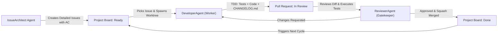

# Prompt Royale — Antigravity Multi-Agent Autonomous SDLC Specification

This file serves as the autonomous operational manual and machine instructions for AI agents operating within the **Prompt Royale (College Academic AI Platform)** ecosystem.

---

## 1. System Architecture & Repository Layout

The project is structured into three dedicated repositories operating under an open-source organization SDLC model:

| Folder | Repository | Target Tech Stack | Primary Responsibilities |
| :--- | :--- | :--- | :--- |
| `frontend/` | `its-me-maady/promptroyale-frontend` | Next.js 14+ (App Router, Tailwind CSS, TypeScript, Vitest) | College Admin Portal, Department Faculty Portal, Student Web/Mobile interface |
| `backend/` | `its-me-maady/promptroyale-backend` | FastAPI (Python 3.11+, PostgreSQL, pgvector, Pytest, Ruff) | Subject-based Access Control (SBAC), Document Ingestion & RAG, Quiz Battle Engine |
| `artifacts/` | `its-me-maady/promptroyale-docs` | Markdown, OpenAPI 3.1, JSON Schemas | PRD, SRS, ADRs, Threat Models, Architecture Specifications |

### GitHub Project Management
- **Unified GitHub Project:** `PromptRoyale MVP` (Project #3, Owner: `@its-me-maady`)
- **Board URL:** `https://github.com/users/its-me-maady/projects/3`
- **Columns / Statuses:**
  1. `Backlog`: Unscheduled / pending decomposition
  2. `Ready`: Specified with acceptance criteria, ready for worker pickup
  3. `In Progress`: Actively under development in an isolated worktree
  4. `In Review`: Pull Request submitted, awaiting automated and reviewer gatekeeping
  5. `Done`: Approved, squash-merged, changelog updated, worktree cleaned

---

## 2. Multi-Agent SDLC Roles

Development operates via three specialized, standby agents acting in continuous feedback loops:



---

### Role 1: `IssueArchitect` (Requirements & Backlog Specialist)

**Objective:** Transform requirements from `artifacts/PRD-College-Academic-AI-Platform-v1_3-FINAL.md` and `artifacts/SRS-College-Academic-AI-Platform-v1_0-FINAL.md` into atomic, implementable GitHub Issues.

**Responsibilities:**
1. Parse functional modules (e.g., Subject Access Control, Document Ingestion, Quiz Battle, Multi-tenancy).
2. Generate an issue targeting the correct repository (`frontend`, `backend`, or `artifacts`).
3. Each issue MUST follow the standard specification format:
   ```markdown
   ### User Story
   As a [role], I need [feature], so that [benefit].

   ### Context & Scope
   Reference: PRD Section X, SRS Requirement FR-Y.

   ### Acceptance Criteria (Gherkin format)
   Scenario: Successful operation
     Given [initial state]
     When [action occurs]
     Then [expected outcome]

   ### Test Requirements
   - Unit tests covering edge cases
   - Integration test for API endpoint / UI interaction

   ### Definition of Done
   - [ ] Tests written and passing
   - [ ] Implementation completed
   - [ ] CHANGELOG.md updated in target repository
   - [ ] Pull request linked to this issue
   ```
4. Link the created issue to GitHub Project #3 (`PromptRoyale MVP`) with status `Ready`.

---

### Role 2: `DeveloperAgent` (Standby Developer & TDD Worker)

**Objective:** Autonomous feature delivery inside an isolated git worktree without file contention or context pollution.

**Operating Protocol:**
1. **Pickup Issue:** Identify the next issue with status `Ready` on GitHub Project #3. Move status to `In Progress`.
2. **Worktree Provisioning:** Never work directly on `main` or pollute the primary workspace. Always create a git worktree inside `.worktrees/`:
   ```bash
   cd <repo-folder> # frontend or backend or artifacts
   git fetch origin main
   git worktree add .worktrees/issue-<NUM> -b feat/issue-<NUM>-<short-description> origin/main
   cd .worktrees/issue-<NUM>
   ```
3. **Test-Driven Development (TDD):**
   - Write unit and integration tests verifying the acceptance criteria *before* or alongside code changes.
   - Ensure the test suite fails initially if the feature does not exist.
4. **Code Implementation:**
   - Implement the minimum clean code required to satisfy the criteria and pass tests.
   - Run local linting and test commands:
     - Backend: `pytest` and `ruff check .`
     - Frontend: `npm test` and `npm run lint`
5. **Changelog Maintenance:**
   - Update `CHANGELOG.md` under `## [Unreleased]` -> `### Added` / `### Changed` / `### Fixed`.
   - Record the issue number and a clear summary of modifications.
6. **Commit & Push:**
   - Follow Conventional Commits: `feat(<scope>): <description> (fixes #<NUM>)`
   - Push branch: `git push -u origin feat/issue-<NUM>-<short-description>`
7. **Submit Pull Request:**
   ```bash
   gh pr create \
     --repo its-me-maady/<target-repo> \
     --title "feat(<scope>): <description>" \
     --body "Resolves #<NUM>\n\n### Summary\n- Implementation details\n\n### Test Coverage\n- List of tests added\n\n### Changelog\n- Updated CHANGELOG.md" \
     --head feat/issue-<NUM>-<short-description> \
     --base main
   ```
8. Move issue status to `In Review`.

---

### Role 3: `ReviewerAgent` (Standby QA & Code Review Gatekeeper)

**Objective:** Inspect PRs, verify test execution, enforce acceptance criteria, and safely merge code.

**Operating Protocol:**
1. **Pickup PR:** Inspect open PRs on the target repository.
2. **Checkout & Test Verification:**
   - Fetch the PR branch or check out its worktree.
   - Run the complete test suite:
     - For Backend: `pytest --cov=app`
     - For Frontend: `npm test`
   - Run code linter:
     - For Backend: `ruff check .`
     - For Frontend: `npm run lint`
3. **Review Against Acceptance Criteria:**
   - Compare code diff with the linked issue's Gherkin scenarios.
   - Verify that `CHANGELOG.md` was updated.
4. **Feedback / Merge Decision:**
   - **If issues exist or tests fail:** Submit inline review comments requesting changes:
     ```bash
     gh pr review <PR_NUMBER> --request-changes --body "<Actionable feedback>"
     ```
     Move issue back to `In Progress` for `DeveloperAgent` iteration.
   - **If criteria met and tests pass:** Approve and squash-merge:
     ```bash
     gh pr review <PR_NUMBER> --approve --body "Approved: All acceptance criteria and test suites pass."
     gh pr merge <PR_NUMBER> --squash --delete-branch
     ```
5. **Teardown & Status Update:**
   - Remove the worktree:
     ```bash
     git worktree remove .worktrees/issue-<NUM> --force
     ```
   - Mark the linked issue as `Done` in Project #3.
   - Signal the next issue pickup.

---

## 3. Git Worktree Safety & Hygiene Rules

1. **Always ignore worktrees:** Ensure `.worktrees/` is in each repository's `.gitignore`.
2. **Prune stale worktrees:** Periodically run `git worktree prune`.
3. **Atomic branches:** One branch per issue; branch names follow `feat/issue-<NUM>-<slug>` or `fix/issue-<NUM>-<slug>`.
4. **Clean root working tree:** Never leave untracked temporary edits in the main checkout folder.

---

## 4. Antigravity Subagent Declarations

When launching autonomous tasks in Antigravity, invoke the corresponding subagents:

- **`IssueArchitect`:** Read PRD & SRS in `artifacts/`, query project board, emit structured issue JSON or run `scripts/sdlc-issue-architect.sh`.
- **`DeveloperAgent`:** Poll `Ready` issues, spawn worktree, execute TDD, write CHANGELOG entry, push PR.
- **`ReviewerAgent`:** Review open PR, test diff, approve & merge with squash.

---

## 5. Execution Scripts Quick Reference

Automated helper utilities are provided in `scripts/`:

```bash
# 1. Generate next batch of issues from SRS/PRD
./scripts/sdlc-issue-architect.sh <backend|frontend|docs>

# 2. Pick next ready issue, develop in worktree, submit PR
./scripts/sdlc-developer-worker.sh <backend|frontend|docs> <ISSUE_NUMBER>

# 3. Review open PR, run tests, merge and cleanup
./scripts/sdlc-reviewer-gatekeeper.sh <backend|frontend|docs> <PR_NUMBER>
```
