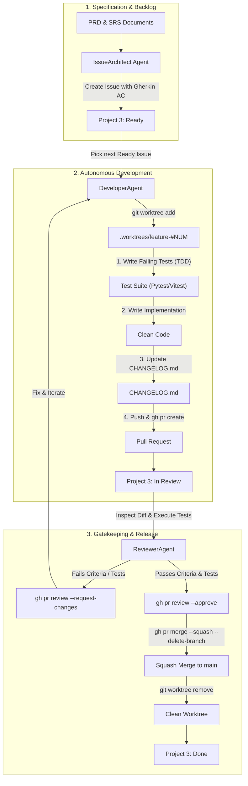

# Prompt Royale — Antigravity Multi-Agent Autonomous SDLC Specification

> **Operational Standard & Agent Constitution**  
> This specification defines the autonomous Software Development Life Cycle (SDLC) operating across the **Prompt Royale (College Academic AI Platform)** open-source organization repositories. It governs how Antigravity AI agents collaborate, isolate work in `git worktrees`, enforce Test-Driven Development (TDD), maintain `CHANGELOG.md`, and gate merges via GitHub Projects and Pull Requests.

---

## 1. Industry References & Architectural Foundations

This SDLC framework synthesizes proven patterns from industry standards and state-of-the-art AI software engineering benchmarks:

1. **SWE-bench & Devin Isolation Standards**: Agentic code changes must execute inside isolated ephemeral workspaces (`git worktrees`) rather than modifying the active tree or `main` directly. This prevents file locking, context corruption, and git index pollution.
2. **Open Source Governance Model**: All contributions follow the standard Open Source Maintainer workflow:
   - Transparent issue backlog with Gherkin acceptance criteria
   - Isolated topic branches (`feat/...`, `fix/...`, `docs/...`)
   - Mandatory test suites passing before review
   - Formal Pull Request reviews with atomic Squash Merges
   - Strict versioning and `CHANGELOG.md` tracking following [Keep a Changelog](https://keepachangelog.com/en/1.1.0/) and [Semantic Versioning 2.0.0](https://semver.org/).
3. **Conventional Commits 1.0.0**: Commit messages and PR titles must strictly follow the format: `<type>(<scope>): <short description>`.

---

## 2. Organization Repositories & Workspace Layout

The Prompt Royale platform is divided into three focused repositories within the local workspace:

```
/home/maady/Projects/promptroyale/
├── AGENTS.md                  # Root agent constitution & instructions
├── .gitignore                 # Root ignore for worktrees, env, caches
├── artifacts -> docs          # Workspace symlink for documentation
├── docs/                      # Repository: its-me-maady/promptroyale-docs
│   ├── PRD-College-Academic-AI-Platform-v1_3-FINAL.md
│   ├── SRS-College-Academic-AI-Platform-v1_0-FINAL.md
│   ├── CHANGELOG.md
│   ├── specs/                 # OpenAPI 3.1 & JSON Schemas
│   └── adr/                   # Architecture Decision Records
├── backend/                   # Repository: its-me-maady/promptroyale-backend
│   ├── app/                   # FastAPI, RAG, SBAC, pgvector
│   ├── tests/                 # Pytest test suite
│   ├── pyproject.toml
│   └── CHANGELOG.md
├── frontend/                  # Repository: its-me-maady/promptroyale-frontend
│   ├── app/                   # Next.js 14 App Router, Web & Mobile Portals
│   ├── package.json
│   ├── tsconfig.json
│   └── CHANGELOG.md
└── scripts/                   # Autonomous SDLC CLI orchestration tooling
    ├── sdlc-issue-architect.sh
    ├── sdlc-developer-worker.sh
    ├── sdlc-reviewer-gatekeeper.sh
    └── sdlc-runner.sh
```

### GitHub Repositories
- **Docs & Architecture:** [`its-me-maady/promptroyale-docs`](https://github.com/its-me-maady/promptroyale-docs)
- **Backend Service:** [`its-me-maady/promptroyale-backend`](https://github.com/its-me-maady/promptroyale-backend)
- **Frontend Applications:** [`its-me-maady/promptroyale-frontend`](https://github.com/its-me-maady/promptroyale-frontend)

---

## 3. GitHub Project Board & Workflow States

All work items across all three repositories are managed on a centralized GitHub Project board:
- **Project Name:** `PromptRoyale MVP`
- **Project Number:** `3`
- **Owner:** `@its-me-maady`
- **Project ID:** `PVT_kwHOCuI-cM4Bew7F`
- **Board URL:** `https://github.com/users/its-me-maady/projects/3`

### Status Columns & Automation Transitions

| Column | Status ID | Description | Responsible Agent |
| :--- | :--- | :--- | :--- |
| **Backlog** | `deabd5a9` | Unrefined or raw requirement candidate | Human / Architect |
| **Ready** | `ffdba244` | Fully specified with Gherkin scenarios & DoD; ready for development | `IssueArchitect` |
| **In Progress** | `b5bd8c7f` | Actively being developed inside an isolated `.worktrees/` directory | `DeveloperAgent` |
| **In Review** | `09a365b9` | Pull Request submitted with passing tests & changelog; awaiting gatekeeper review | `DeveloperAgent` |
| **Done** | `68d66a29` | Reviewed, approved, squash-merged to `main`, worktree pruned | `ReviewerAgent` |

---

## 4. Multi-Agent SDLC Roles & Operating Protocols



---

### Role 1: `IssueArchitect` (Requirements Engineer)

**Trigger:** New features from `artifacts/PRD-College-Academic-AI-Platform-v1_3-FINAL.md` or `artifacts/SRS-College-Academic-AI-Platform-v1_0-FINAL.md`.

**Responsibilities:**
1. Break down high-level requirements into atomic, single-responsibility issues.
2. Target the appropriate repository (`backend`, `frontend`, or `docs`).
3. Enforce the **Mandatory Issue Template**:
   ```markdown
   ### User Story
   As a [role], I need [feature], so that [business/academic outcome].

   ### Context & Scope
   Reference: PRD Section [X], SRS Requirement [FR-Y].

   ### Acceptance Criteria (Gherkin format)
   Scenario: [Scenario title]
     Given [preconditions]
     When [action/event occurs]
     Then [observable outcome]

   ### Test Requirements
   - Unit tests covering positive and negative edge cases
   - Integration / Contract test validating payload and status codes

   ### Definition of Done
   - [ ] Unit & integration tests written and passing
   - [ ] Implementation satisfies all Gherkin scenarios
   - [ ] CHANGELOG.md updated in target repository (Keep a Changelog format)
   - [ ] Pull Request submitted referencing 'Fixes #<NUM>'
   ```
4. Add the issue to GitHub Project #3 and set Status to `Ready`.

---

### Role 2: `DeveloperAgent` (Standby TDD Worker)

**Trigger:** Issues available in `Ready` on Project #3.

**Operating Protocol:**
1. **Pickup:** Select the highest priority issue with Status `Ready`.
2. **Move Status:** Change issue status on Project #3 to `In Progress`.
3. **Provision Isolated Git Worktree:**
   ```bash
   cd /home/maady/Projects/promptroyale/<target-repo>
   git fetch origin main
   git worktree add .worktrees/issue-<NUM> -b feat/issue-<NUM>-<short-description> origin/main
   cd .worktrees/issue-<NUM>
   ```
4. **Execute Test-Driven Development (TDD):**
   - **RED:** Write unit/integration tests verifying the Gherkin acceptance criteria in `tests/`. Verify tests fail as expected.
   - **GREEN:** Write the minimal clean implementation code to make all tests pass.
   - **REFACTOR:** Clean up code structure, ensure typing, and eliminate redundancy.
5. **Run Local Validation:**
   - **Backend:** `pytest -v` and `ruff check .`
   - **Frontend:** `npm test` and `npm run lint`
   - **Docs:** Markdown linting / OpenAPI schema validation
6. **Update CHANGELOG.md:**
   - Add entry under `## [Unreleased]` following standard sections (`Added`, `Changed`, `Fixed`).
   - Format: `- [#<NUM>] <Detailed explanation of feature/fix> (closes #<NUM>)`
7. **Commit & Push:**
   - Conventional commit: `feat(<scope>): <description> (fixes #<NUM>)`
   - Push branch: `git push -u origin feat/issue-<NUM>-<short-description>`
8. **Create Pull Request:**
   ```bash
   gh pr create \
     --repo its-me-maady/<target-repo> \
     --title "feat(<scope>): <description>" \
     --body "Fixes #<NUM>

   ### Changes
   - Implementation summary

   ### Acceptance Criteria Verification
   - [x] Scenario 1 verified via test_sbac.py

   ### Changelog
   - [x] CHANGELOG.md updated" \
     --head feat/issue-<NUM>-<short-description> \
     --base main
   ```
9. **Update Project Board:** Move issue status on Project #3 to `In Review`.

---

### Role 3: `ReviewerAgent` (Standby QA & Merge Gatekeeper)

**Trigger:** Open Pull Requests on any of the three repositories in status `In Review`.

**Operating Protocol:**
1. **Checkout & Test Verification:**
   - Fetch the PR head branch into an isolated review worktree or test runner.
   - Execute the test suite and linters against the exact PR diff.
2. **Acceptance Criteria Verification:**
   - Cross-check the PR changes directly against the Acceptance Criteria in the linked Issue.
   - Verify that test coverage is authentic (no mocked trivial assertions).
3. **Changelog & Quality Audit:**
   - Verify that `CHANGELOG.md` was appropriately updated in the PR.
   - Verify no secrets, temporary debug files, or untracked changes are introduced.
4. **Gating Decision:**
   - **If review fails or tests break:**
     ```bash
     gh pr review <PR_NUM> --request-changes --body "<Detailed report of missing criteria or test failure>"
     ```
     Move Project #3 status back to `In Progress` for `DeveloperAgent` remediation.
   - **If review passes 100%:**
     ```bash
     gh pr review <PR_NUM> --approve --body "Approved: All acceptance criteria and automated test suites pass. Changelog verified."
     gh pr merge <PR_NUM> --squash --delete-branch
     ```
5. **Post-Merge Cleanup:**
   - Remove the local worktree:
     ```bash
     cd /home/maady/Projects/promptroyale/<target-repo>
     git worktree remove .worktrees/issue-<NUM> --force
     git worktree prune
     ```
   - Advance the issue status on Project #3 to `Done`.
   - Signal the `DeveloperAgent` for the next available issue.

---

## 5. Automation CLI Tooling (`scripts/`)

To streamline autonomous agent execution, the following shell commands provide deterministic, reproducible operations:

### 1. Issue Architect Tool
```bash
./scripts/sdlc-issue-architect.sh <backend|frontend|docs> "<Title>" "<BodyFileOrString>"
```
- Creates the issue on the target GitHub repository.
- Links the issue to GitHub Project #3 (`PromptRoyale MVP`).
- Sets Project Status to `Ready`.

### 2. Developer Worker Tool
```bash
./scripts/sdlc-developer-worker.sh <backend|frontend|docs> <ISSUE_NUMBER> <BRANCH_SLUG>
```
- Fetches `origin/main`.
- Provisions `.worktrees/issue-<NUM>`.
- Updates Project Status to `In Progress`.
- Prepares test files and development workspace.

### 3. Reviewer Gatekeeper Tool
```bash
./scripts/sdlc-reviewer-gatekeeper.sh <backend|frontend|docs> <PR_NUMBER>
```
- Fetches PR, runs test suite.
- Checks `CHANGELOG.md`.
- Approves and squash-merges if passing, or posts change requests if failing.
- Cleans up worktrees and moves Project Status to `Done`.

### 4. SDLC Master Orchestrator
```bash
./scripts/sdlc-runner.sh status
./scripts/sdlc-runner.sh cycle <backend|frontend|docs>
```
- Displays current status of all 3 repos and Project #3 items.
- Runs a complete end-to-end cycle (Issue -> Worktree -> TDD -> PR -> Review -> Merge).

---

## 6. Antigravity Agent Guidelines

When operating inside Antigravity:
1. Always refer to `/home/maady/Projects/promptroyale/AGENTS.md` as the source of truth.
2. Maintain documentation integrity: Never alter existing PRD or SRS specifications without explicit issue tracking.
3. Keep working trees clean: Never execute development code on `main`. Always work inside `.worktrees/`.
4. Work step-by-step: Complete the full cycle (Code -> Test -> Changelog -> PR -> Review -> Merge) for one feature before initiating the next.
